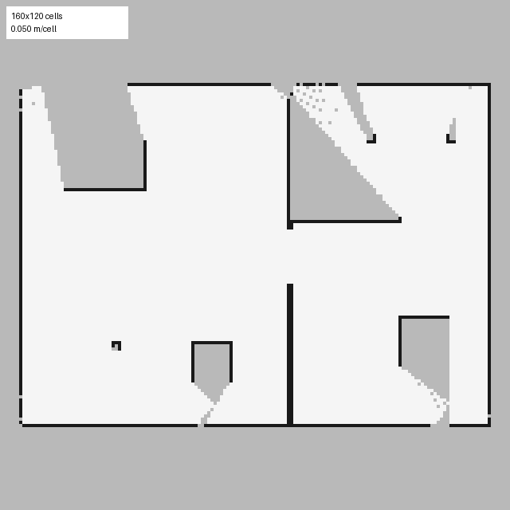
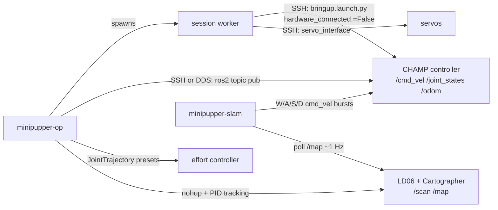

# Mini Pupper Operator

**Drive, pose, and map with a Mini Pupper quadruped from your laptop, on the stock ROS 2 Humble image.**

[](https://github.com/joey12725/minipupper-operator/actions/workflows/ci.yml)


<p align="center">
  
  <br>
  <sub>The live-map panel of <code>minipupper-slam</code>. This one is drawn from a synthetic LiDAR sweep by <code>scripts/render_demo_map.py</code>.</sub>
</p>

[Mini Pupper](https://github.com/mangdangroboticsclub/mini_pupper) is MangDang's open-source, 12-servo robot dog with a Raspberry Pi, an IMU, an LD06 LiDAR, and a ROS 2 stack built on CHAMP. Out of the box, the robot image boots without starting ROS, the full-hardware bringup is unstable, the SLAM launch file needs an RViz the image doesn't ship, and posture commands on `/body_pose` barely move the legs.

This repo is the layer I built on top of it to get from "it boots" to "it's mapping the room while I steer it." It's one CLI and a small desktop app that keep the robot's ROS graph alive from your machine, drive and pose it with guardrails, and run headless Cartographer SLAM while you steer with W/A/S/D. Every workaround in the code traces back to something I found on the hardware, and those findings are written up in the [field notes](docs/field-notes.md).

## Features

- **One-command bringup.** `minipupper-op bringup_robot` inspects the robot, then starts a detached session worker that holds `mini_pupper_bringup` and `servo_interface` open over two SSH sessions and checks that `/cmd_vel`, `/joint_states`, `/odom`, and the effort controller all came up.
- **Bounded motion with a guaranteed stop.** `move_robot` publishes `/cmd_vel` for a set time and then always sends an explicit zero twist. Speeds and durations are checked against a bench-test envelope before anything connects.
- **Joint-space pose presets.** `set_joint_pose --preset stand|sit|lay|neutral` sends `JointTrajectory` messages straight to the effort controller. That path worked on the real robot where CHAMP's `/body_pose` didn't.
- **Headless SLAM.** `start_slam` launches the LD06 driver, `cartographer_node`, and the occupancy-grid node without RViz, tracks their PIDs, and waits for `/scan`, `/submap_list`, and `/map`.
- **Teleop and live map.** `minipupper-slam` is a Tk window with W/A/S/D driving, Space to stop, and the `/map` occupancy grid refreshing about once a second.
- **Works without local ROS.** In the default SSH mode you only need Python on the desktop. Install ROS 2 locally (or in WSL on Windows) and `--mode dds` talks to the robot over DDS directly.
- **Dry run.** `--dry-run` prints the exact shell a motion command would run on the robot, so you can review it before the robot is on the floor.
- **ROS 2 node.** `ros2_ws/src/pose_toggler` cycles the robot through pose presets on a timer and is configurable with ROS parameters.
- **Docs and community search.** `minipupper-docs` chunks documentation and Discord-style chat exports, embeds them, and stores them in DuckDB, so you can paste an error message and get the threads where someone else hit it.

## What I fixed on top of the stock platform

| On the stock robot | What this repo does |
| --- | --- |
| `robot.service` runs a `run.sh` that only shows the IP; nothing starts ROS. | A session worker on the desktop keeps bringup and the servo interface running over SSH, with status and logs in `.minipupper/`. |
| Full-hardware `bringup.launch.py` didn't produce a usable graph. | Bringup runs with `hardware_connected:=False` and `servo_interface` starts separately, which proved stable. |
| Servo calibration in EEPROM was plain text while the Python stack expected a pickle, so every neutral angle fell back to zero. | Diagnosed and converted on the robot; the pose presets here were tuned after that fix. |
| `/body_pose` didn't produce useful posture changes. | Named presets go straight to `/joint_group_effort_controller/joint_trajectory`. |
| `mini_pupper_slam` launch fails because `rviz2` isn't installed. | SLAM runs headless: LiDAR driver, Cartographer, and the occupancy-grid node, each started and tracked on its own. |
| LiDAR reported `communication is abnormal` on every serial port and profile. | Traced to a bad USB cable; with a good one the CP210x shows up as `/dev/ttyUSB0` and the stock `ld06.launch.py` works. |
| After restarts, `ros2 topic list` kept showing stale topics. | Every remote command runs `ros2 daemon stop` first. |
| Brownouts and reboots under motion on a bench supply. | Traced to the supply and its clip leads sagging under servo current. Run motion tests on the battery. |

## Quickstart

```bash
git clone https://github.com/joey12725/minipupper-operator.git
cd minipupper-operator
python -m venv .venv && source .venv/bin/activate   # Windows: .venv\Scripts\activate
pip install -e ".[viewer]"

cp robot_config.example.json robot_config.json      # set robot_ip
export ROBOT_PASSWORD='<robot-password>'            # or leave unset to be prompted

minipupper-op presets
minipupper-op --dry-run move_robot --linear-x 0.15 --duration-sec 1.5   # see exactly what will run
```

Then, with the robot on a stand for the first run:

```bash
minipupper-op bringup_robot                         # start and verify the ROS graph
minipupper-op read_state                            # topics + one sample of joints, IMU, odom, scan
minipupper-op set_joint_pose --preset stand
minipupper-op move_robot --linear-x 0.15 --duration-sec 1.5
minipupper-op move_robot --angular-z 0.6 --duration-sec 1.0
minipupper-op stop_robot                            # emergency stop

minipupper-op start_slam                            # LiDAR + headless Cartographer
minipupper-slam                                     # drive with W/A/S/D, watch /map fill in
minipupper-op shutdown                              # stop SLAM, stop the robot, end the worker
```

`minipupper-slam` needs Tk, which ships with the python.org installers and most Linux distros (`sudo apt install python3-tk`).

## Robot setup

The tools expect the stock MangDang ROS 2 Humble image:

- Ubuntu 22.04 with ROS 2 Humble at `/opt/ros/humble`
- [`mini_pupper_ros`](https://github.com/mangdangroboticsclub/mini_pupper_ros) built in `~/ros2_ws` (`mini_pupper_bringup`, `mini_pupper_driver`, `mini_pupper_slam`, CHAMP, `ldlidar_stl_ros2`)
- SSH enabled for the `ubuntu` user, with the robot and desktop on the same network
- For SLAM: the LD06 LiDAR on USB (`/dev/ttyUSB0`)

Find the robot's IP on its display or your router, then set it with `--robot-ip`, `ROBOT_IP`, or `robot_config.json`. Running `minipupper-op bringup_robot` prints the hostname, OS, and whether ROS 2, the workspace, and `mini_pupper_bringup` are present before it starts anything.

## Configuration

Every setting resolves in the same order: command-line flag, then environment variable, then `robot_config.json`, then the default.

| Setting | Flag | Env var | Config key | Default |
| --- | --- | --- | --- | --- |
| Robot address | `--robot-ip` | `ROBOT_IP` | `robot_ip` | none, required |
| SSH user | `--ssh-user` | `ROBOT_SSH_USER` | `ssh_user` | `ubuntu` |
| SSH password | | `ROBOT_PASSWORD` | `ssh_password` | prompt |
| ROS domain | `--ros-domain-id` | `ROS_DOMAIN_ID` | `ros_domain_id` | `42` |
| Control path | `--mode` | `MINIPUPPER_MODE` | `preferred_mode` | `auto` |
| Robot model | | `ROBOT_MODEL` | `robot_model` | `mini_pupper` |
| Config file | `--config` | `MINIPUPPER_CONFIG` | | `./robot_config.json` |
| Session state dir | | `MINIPUPPER_STATE_DIR` | | `./.minipupper` |
| WSL distro (Windows DDS mode) | | `MINIPUPPER_WSL_DISTRO` | | `Ubuntu` |

`robot_config.json` and `.minipupper/` are gitignored. Prefer `ROBOT_PASSWORD` or the prompt over writing the password into the file.

## How it works



The full design, including the control modes, the motion-safety rules, headless SLAM, and how to add commands or poses, is in [docs/architecture.md](docs/architecture.md).

## ROS 2 node: `pose_toggler`

```bash
cd ros2_ws && colcon build && source install/setup.bash
ros2 run pose_toggler pose_toggler --ros-args -p period_s:=3.0 -p "sequence:=[stand, sit, lay]"
```

It publishes the next preset to the effort controller every `period_s` seconds. CI builds it and runs its tests in a `ros:humble-ros-base` container.

## Docs search

```bash
pip install -e ".[docs]"
export OPENROUTER_API_KEY=...
minipupper-docs ingest path/to/minipupper-docs.txt
minipupper-docs ingest --type chat path/to/discord-export.txt
minipupper-docs search "ldlidar communication is abnormal"
```

Bring your own sources, such as a text export of the [Mini Pupper docs](https://minipupperdocs.readthedocs.io/) or a DiscordChatExporter dump. The index lives in one `pupper_docs.duckdb` file, and unchanged files are skipped on re-ingest.

## Repository layout

```
src/minipupper_operator/   CLI, session worker, SLAM viewer, map renderer, docs search
ros2_ws/src/pose_toggler/  ROS 2 (ament_python) pose-cycling node
tests/                     pytest suite for the pure logic and the CLI surface (no robot needed)
docs/                      architecture, field notes, assets
experiments/               Gazebo + noVNC Compose stacks and a ROS 2 dev container
scripts/                   demo-map generator
sources/mini_pupper_ros    upstream MangDang stack, pinned as a git submodule (optional)
```

## Development

```bash
pip install -e ".[dev,docs]"
ruff check . && ruff format --check .
pytest
```

The tests cover message construction, pose presets, topic selection, motion limits, config precedence, dry-run output, map rendering, and docs chunking. None of them need a robot or ROS.

## Tech stack

Python 3.10+, Paramiko, ROS 2 Humble (rclpy, CHAMP, Cartographer, ldlidar_stl_ros2), Tkinter and Pillow, DuckDB with OpenRouter embeddings, Docker Compose, GitHub Actions.

## Credits and license

The Mini Pupper hardware and the `mini_pupper_ros` stack are by [MangDang](https://github.com/mangdangroboticsclub) under Apache-2.0. They are inspired by the [Stanford Pupper](https://github.com/stanfordroboticsclub/StanfordQuadruped/). This repo doesn't copy any of that code: the upstream stack is referenced as a submodule and driven at runtime. See [THIRD_PARTY_NOTICES.md](THIRD_PARTY_NOTICES.md).

Everything else is released under the [MIT License](LICENSE).

Built by [Joey Hersh](https://github.com/joey12725).
