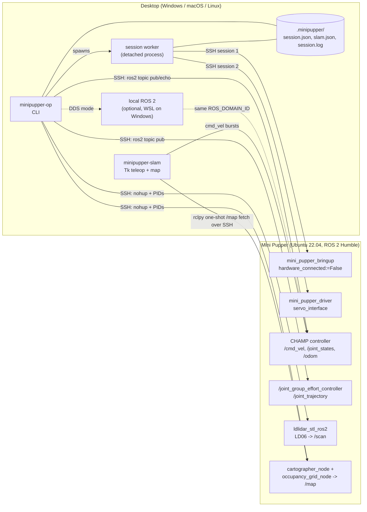

# Architecture

## Why a desktop-side worker

The stock image ships a `robot.service` whose `run.sh` only shows the IP
address and has a `#TODO: Add ros2 launch`. Nothing keeps the ROS graph up.
Rather than modify the robot image, `bringup_robot` spawns a detached copy of
the CLI (`session_worker`) that opens two SSH sessions and `exec`s
`ros2 launch mini_pupper_bringup ... hardware_connected:=False` in one and
`ros2 run mini_pupper_driver servo_interface` in the other. Those two
together produced a stable graph on the robot; the full-hardware bringup did
not. The worker logs both streams to `.minipupper/session.log` and records its
PID and status in `.minipupper/session.json`. When either remote process exits,
the worker marks itself `bringup_exited` or `servo_exited` and stops.

Every other command checks that the worker is alive before it publishes.

## Control paths

`--mode` chooses how commands reach ROS:

| Mode | How it works | When to use |
| --- | --- | --- |
| `ssh` | Runs `ros2 topic ...` on the robot over Paramiko. | Default. Works with nothing but Python on the desktop. |
| `dds` | Runs `ros2 topic ...` locally (in WSL on Windows) on the same `ROS_DOMAIN_ID`. | Desktop has ROS 2 Humble and multicast works on your network. |
| `auto` | Tries `dds`, falls back to `ssh` with the reason printed. | Mixed setups. |

Every SSH command runs `ros2 daemon stop` first. A stale daemon on the robot
kept serving the pre-bringup topic list, which made discovery look broken
after restarts.

## Motion safety

- `move_robot` publishes `/cmd_vel` at 10 Hz under `timeout`, then always
  publishes one explicit zero `Twist`. `timeout` exiting 124 counts as success,
  so the stop runs even when the drive phase is cut short.
- Requests are checked against a bench-test envelope before anything connects
  (`|v| <= 0.5 m/s`, `|w| <= 2.0 rad/s`, `0 < t <= 30 s`); see
  `minipupper_operator/messages.py`.
- `stop_robot` sends a zero twist immediately. In the viewer, Space does the
  same, and every teleop burst ends in a zero twist, so letting go of the
  keys stops the robot.
- `--dry-run` prints the exact remote shell for motion commands without
  connecting, so you can review what will run before the robot is on the floor.

## Posture: joint space over body pose

CHAMP subscribes to `/body_pose`, but on this robot it did not produce useful
posture changes. Publishing `trajectory_msgs/JointTrajectory` directly to
`/joint_group_effort_controller/joint_trajectory` did. The presets in
`messages.JOINT_POSE_PRESETS_DEG` (neutral, stand, sit, lay) were tuned on the
hardware after the calibration fix in the [field notes](field-notes.md), and
the `pose_toggler` ROS 2 node uses the same path.

## Headless SLAM

`mini_pupper_slam`'s launch file also starts RViz, which the robot image does
not have, so the launch fails. `start_slam` starts the three pieces on their
own with `nohup`, records their PIDs locally, and waits for `/scan`,
`/submap_list` and `/map`:

1. `ros2 launch ldlidar_stl_ros2 ld06.launch.py`
2. `cartographer_node` with the stock `mini_pupper_slam/config/slam.lua`, with
   `/imu/data` remapped to `/imu`
3. `cartographer_occupancy_grid_node`

If the topics do not appear within 20 s, the processes are killed and the
robot-side log paths are printed. `stop_slam` kills them by PID.

## Map viewer

`minipupper-slam` polls `/map` about once a second by running a short rclpy
script on the robot over SSH that grabs one `OccupancyGrid` and prints it as
JSON. `map_render.snapshot_to_image` flips the grid (ROS rows start at the
bottom), colours unknown/free/occupied cells, and letterboxes it to the
640 px panel. Teleop runs on its own thread, sending short `cmd_vel` bursts
while W/A/S/D are held.

## Module map

| Module | Responsibility |
| --- | --- |
| `minipupper_operator/cli.py` | Config resolution, SSH and local-shell plumbing, session worker, command handlers. |
| `minipupper_operator/messages.py` | Pure helpers: message literals, presets, topic selection, motion limits, teleop mapping, occupancy colours. |
| `minipupper_operator/map_render.py` | OccupancyGrid to PIL image. |
| `minipupper_operator/slam_viewer.py` | Tk app: buttons, key bindings, map and teleop threads. |
| `minipupper_operator/docs_search.py` | Chunk, embed and search docs and chat exports in DuckDB. |
| `ros2_ws/src/pose_toggler` | ROS 2 node that cycles joint presets. |

## Extending

- **New pose:** add a 12-value entry to `JOINT_POSE_PRESETS_DEG` (and to
  `pose_toggler/presets.py` if the node should know it). It shows up in
  `set_joint_pose --preset` and `presets` automatically.
- **New command:** add a subparser in `build_parser`, a `handle_*` function,
  and an entry in the `handlers` table in `main`. Put message building in
  `messages.py` so it can be unit tested. If it moves the robot, add it to
  `MOTION_COMMANDS` so `--dry-run` covers it.
- **Mini Pupper 2:** set `robot_model` to `mini_pupper_2`. Joint names are the
  same; the presets were tuned on a Mini Pupper 1, so re-tune them.
